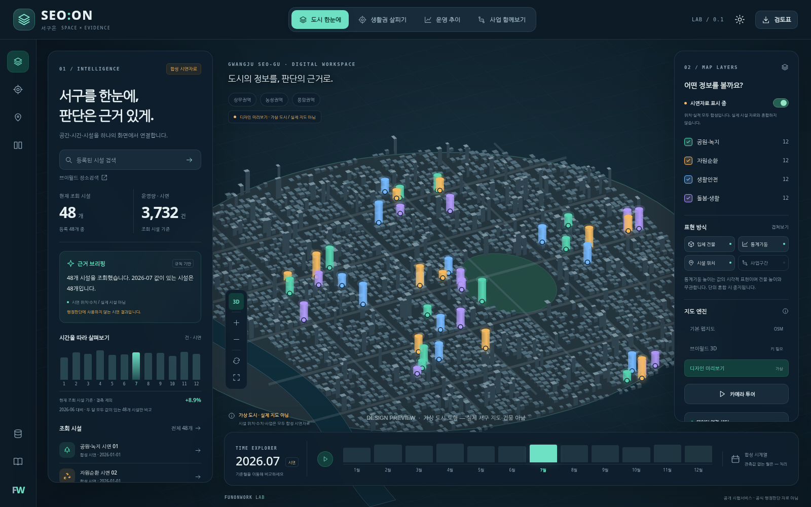

# SEO:ON · 서구온
### 도시의 정보를, 판단의 근거로.

**FUNONWORK LAB | 인터넷용 공간행정 웹 시제품 | v0.1.0**

Unity 없이 브라우저에서 입체 건물·시설·월별 통계와 근거 패널을 함께 보여주는 웹 프로젝트입니다. GitHub 저장소의 루트에 업로드하고 Vercel로 배포할 수 있도록 구성했습니다. 별도 npm 패키지 설치 없이 빌드하며, 실제 지도 모드에서는 외부 지도 라이브러리와 타일을 읽습니다.

> **처음 제공되는 시설 48개, 사업 6개, 월별 수치는 전부 합성 시연자료입니다. 실제 서구 시설·실적·사업으로 사용하면 안 됩니다. 아래 화면도 ‘가상 도시 디자인 미리보기’이며 실제 서구 지도가 아닙니다.** 기본 웹지도 모드의 코드는 실제 OSM 지리정보를 사용하도록 작성되어 있지만, 이번 제작환경에서는 외부 지도·인증 API·Vercel 실제 배포를 검증하지 못했습니다.



## 먼저 할 일

1. `START_HERE.md`를 읽습니다.
2. 압축을 풀고 **package.json, vercel.json이 저장소 최상위에 보이도록** GitHub에 올립니다. ZIP 파일만 업로드하면 배포되지 않습니다.
3. Vercel에서 해당 저장소를 Import합니다. Framework `Other`, Build `npm run build`, Output `dist`, Node.js `22.x`입니다.
4. 키 없이 기본 배포를 먼저 확인합니다. 실제 지도에는 인터넷·WebGL이 필요합니다. 실패하면 오류를 표시하며, 가상 지도에 자동 대체하지 않습니다.
5. 브이월드는 배포 도메인을 발급기관에 등록한 뒤 Vercel 환경변수를 추가하고 재배포합니다. 화면의 **데이터 연결 센터**에서 실제 인증을 시험합니다.

자세한 내용: [Vercel 배포](docs/DEPLOY_VERCEL.md) · [API 설정](docs/API_SETUP.md) · [자료와 한계](docs/DATA_AND_LIMITS.md) · [검증 기록](docs/TEST_REPORT.md)

## 화면과 기능

| 구성 | 이번 버전의 구현 내용 |
|---|---|
| 시각화 | 밝은·어두운 테마, 입체 건물, 색상별 시설, 통계기둥, 사업선, 카메라 투어 |
| 도시 한눈에 | 시설 종류·명칭 검색, 지도·표·통계 연동, 출처와 시연 여부 표시 |
| 생활권 살피기 | 지도 기준점 선택, 300/500/800/1000m 직선거리 반경 조회, 가상시설 배치 |
| 운영 추이 | 월별 시간축·재생·차트, 결측과 0 구분, 두 달 모두 값이 있는 시설만 증감 비교 |
| 사업 함께보기 | 합성 사업의 대표점 근접 + 일정 중첩 조회. 실제 구역의 중첩 계산은 아님 |
| 기록 | A/B 조건 저장과 JSON 내보내기, 조회시설 CSV, 지도·출처가 있는 HTML 검토표 |
| 자료 연결 | 로컬 GeoJSON 불러오기, 저장소의 공개 GeoJSON 읽기, 한 종류의 시설 API 매핑 |
| 모바일 | 분석 패널 열기, 지도·자료 설정, 반응형 화면 |

‘근거 브리핑’은 **규칙 기반 설명**입니다. AI 모델/API 키, 모델 학습, 자유문답형 LLM 기능은 포함하지 않습니다. 수치 계산은 작성된 함수가 수행합니다.

## 지도 세 가지

| 모드 | 데이터 | 키 | 이번 검증 범위 |
|---|---|---|---|
| 기본 웹지도 | OpenFreeMap/OSM 실제 도로·건물 도형을 요청 | 불필요 | 연동 코드 작성. 외부 타일 수신과 서구 제공범위 미검증 |
| 브이월드 3D | VWorld WebGL 3.0 SDK의 지형·건물 | 브라우저용 키 + 등록 도메인 | 브리지 작성. 유효 키와 운영 도메인 인증 미검증 |
| 디자인 미리보기 | 자체 생성한 가상 도시 | 불필요 | 로컬 Chromium에서 화면·조작 검증 |

기본 웹지도의 건물은 OSM 도형 기반 입체화입니다. 일부 높이는 기본값으로 표현되고, 누락될 수 있습니다. 정밀 측량모형·검증된 디지털트윈 예측모형이 아닙니다. 브이월드 건물의 색상이나 표시방식은 제공 SDK 기능에 따르며, 참고사진의 백색 건물을 그대로 보장하지 않습니다.

## 로컬 실행

Node.js 22가 설치된 환경에서 다음을 실행합니다. npm 패키지 다운로드가 빌드에 필요하지 않습니다.

```bash
npm run dev
# http://127.0.0.1:4173

npm run check
npm test
npm run build
npm run preview
```

로컬 API 시험은 `.env.example`을 `.env.local`로 복사하고 값을 채운 다음 개발서버를 다시 시작합니다. 실제 지도 라이브러리와 타일을 받으려면 인터넷에 연결해야 합니다. 환경변수 파일은 커밋하지 마세요.

## 저장소 구조

```text
index.html                   시작 화면
src/app.js                   상태·동작·입출력
src/ui.js / styles.css        화면·테마·반응형 스타일
src/map.js                   웹지도 / 브이월드 / 디자인 미리보기 어댑터
src/preview-scene.js          가상 도시 Canvas 렌더러
src/geo.js / data.js          계산·검증·합성 시연자료
src/vworld-frame.*           브이월드 iframe 브리지
api/config.js                비밀값 없는 연결 설정 확인
api/vworld.js                브이월드 장소검색·행정경계 조회
api/vworld-scene.js          공개용 SDK 키로 3D 프레임 생성
api/public-data.js           설정된 시설 JSON API 1페이지 수집·정규화
server/                      검증·시간제한·응답 크기제한
public/data/                 비어 있는 실제자료 파일과 입력 양식
scripts/                     개발서버·빌드·문법검사·미리보기 생성
preview/design-preview.html  서버 없이 외형·조작만 보는 단일 HTML
vercel.json                  배포 설정
.env.example                 환경변수 이름과 설명, 실제 키 없음
```

## 실제 데이터로 바꾸는 방법

**빠른 시험:** 데이터 연결 센터 → GeoJSON 가져오기. 파일은 현재 브라우저 메모리에만 있으며 새로고침하면 사라집니다. 모든 사용자에게 공유되거나 서버·AI에 업로드되지 않습니다.

**공개 자료:** `public/data/facilities.geojson`에 검수된 Point 자료를 넣고 재배포합니다. 화면에서 시연 스위치를 끄거나 ‘저장소 공개자료 읽기’를 누릅니다. 기본값은 여전히 시연 모드입니다. 운영용 기본값 전환은 별도 검수가 끝난 뒤 `src/app.js` 초기 상태와 자료 로딩 흐름을 수정해야 합니다.

**API 자료:** 키뿐 아니라 API 주소, 실제 열 이름, 출처, 기준일을 등록합니다. GeoJSON/JSON의 지표 이름·단위가 서로 다르면 합산·통계기둥을 중지합니다. 여러 API의 자동 조합, 주소→좌표 자동 변환, SHP/CityGML/3D Tiles 변환은 이번 버전에 없습니다.

## 출처·이용조건

작성 코드에는 MIT 라이선스를 적용합니다. 지도·공공데이터에는 각 제공기관의 이용조건과 표시의무가 별도로 적용됩니다. 로고·출처 표시는 지우지 않습니다. [THIRD_PARTY_NOTICES.md](THIRD_PARTY_NOTICES.md), [SECURITY.md](SECURITY.md)를 함께 확인하세요.

참고한 공식 문서: [MapLibre 입체 건물](https://maplibre.org/maplibre-gl-js/docs/examples/display-buildings-in-3d/), [OpenFreeMap](https://openfreemap.org/quick_start/), [VWorld 3D](https://www.data.go.kr/data/3073144/openapi.do), [VWorld 공식 샘플](https://github.com/V-world/V-world_API_sample), [Vercel Node 함수](https://vercel.com/docs/functions/runtimes/node-js), [Vercel 환경변수](https://vercel.com/docs/environment-variables).

**이 프로젝트는 공개 기술시험용 기반 코드이며, 기관 공식 서비스·실시간 관제·정밀 시뮬레이션의 완성이나 인증을 의미하지 않습니다.**
